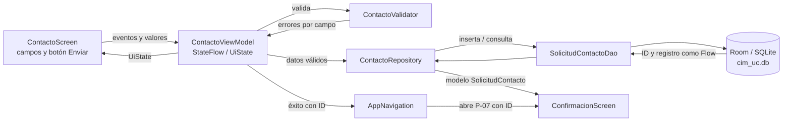

# CIM UC

Aplicación Android académica para explorar información ficticia del Centro UC de Innovación en Madera y registrar solicitudes de contacto simuladas. La app se construye con Kotlin, Jetpack Compose, Material 3 y arquitectura MVVM. Los datos se almacenan localmente en Room/SQLite; este MVP no conecta con un servidor.

## Integrantes

| Nombre             |
| ------------------ |
| Juan Pablo Casassa |
| Martin Gonzalez    |
| Claudio Jaime      |
| Lucas Vargas       |

## Qué muestra cada pantalla

| Pantalla | Qué ve la persona | Con qué se conecta |
| --- | --- | --- |
| **P-01 Inicio** | Bienvenida, buscador y tarjetas de acceso a Proyectos, Capacidades I+D, Integrantes, Publicaciones y Actividades. Cada tarjeta muestra la cantidad de registros. | Las tarjetas de contenido abren P-02 con el tipo seleccionado; Actividades abre P-05. |
| **P-02 Explorar** | Buscador, filtros por área y año, filtros activos, contador de resultados y tarjetas de resultados. Si no hay coincidencias, muestra un estado vacío. | Al seleccionar una tarjeta, abre P-03 con el proyecto seleccionado. El estado de búsqueda y filtros lo administra `ExplorarViewModel`. |
| **P-03 Detalle** | Título, año, estado, área temática y descripción del proyecto. | Desde aquí se puede ir a P-04 para ver contenido relacionado, a P-05 con el área del proyecto seleccionada o a P-06 con el proyecto referido. En `feat/recursos-nativos` también se agrega compartir y redactar correo. |
| **P-04 Relacionados** | Secciones de integrantes, capacidades I+D y publicaciones asociadas al proyecto. Las relaciones se presentan en tarjetas o listas; si falta información, se indica que no hay elementos asociados. | Mantiene el proyecto de origen y permite abrir P-06 con ese proyecto como referencia. |
| **P-05 Actividades** | Filtro por área temática y tarjetas de actividades con tipo, título, fecha y descripción. | El filtro actualiza el contenido mostrado. Se puede acceder desde Inicio o desde P-03. |
| **P-06 Contacto** | Proyecto referido de solo lectura y campos para nombre, correo ficticio, organización, motivo y mensaje. Los errores se muestran junto al campo correspondiente. | `ContactoViewModel` valida los datos y `ContactoRepository` guarda la solicitud localmente. Si es válida, se navega a P-07; si hay errores, permanece en P-06 y conserva los valores. |
| **P-07 Confirmación** | Confirmación y resumen de la solicitud guardada, incluido el proyecto referido. | Recibe el ID de solicitud, consulta Room y ofrece volver a Inicio. |

Las pantallas se describen según la implementación y los mockups del proyecto; algunos detalles pueden variar entre ramas hasta que sus cambios se integren.

## Arquitectura y flujo de datos

La UI muestra estado y emite eventos. El ViewModel coordina la lógica de presentación, el validador aplica reglas del formulario y el repositorio media el acceso a datos. La UI no consulta SQLite directamente.



### Paso a paso del formulario

1. `ContactoScreen` presenta campos controlados por el estado del ViewModel. Al escribir o enviar, delega el evento mediante callbacks.
2. `ContactoViewModel` actualiza `ContactoUiState` y ejecuta `ContactoValidator` al enviar. Si hay errores, actualiza los mensajes de error sin borrar el contenido escrito.
3. Si los datos son válidos, el ViewModel cambia al estado de envío y llama a `ContactoRepository`.
4. El repositorio crea `SolicitudContactoEntity` y utiliza `SolicitudContactoDao` para insertarla. Room guarda la fila en SQLite y devuelve el ID generado.
5. La navegación abre P-07 con ese ID. `ContactoRepository` vuelve a consultar la solicitud como `Flow`, transforma la entidad al modelo `SolicitudContacto` y la pantalla de confirmación muestra sus datos.

### Dónde quedan los datos

Room es una biblioteca de persistencia sobre SQLite. La base se llama `cim_uc.db` y vive en el almacenamiento privado de la app en el dispositivo. No se envía el formulario a una API o base de datos remota. El catálogo de proyectos y contenido es ficticio y se precarga desde `CimSeedData`; las solicitudes se insertan en la tabla `solicitud_contacto`.

Las entidades Room describen tablas y columnas (por ejemplo, `String` se almacena como `TEXT` y los identificadores `Int` como `INTEGER`). Las claves foráneas y tablas de unión conectan proyectos con áreas, integrantes, capacidades y publicaciones. `AppDatabase` registra entidades y DAOs, y define la versión y migraciones del esquema. En Android Studio, se puede inspeccionar la base mientras la app corre desde **View → Tool Windows → App Inspection → Database Inspector**, seleccionando la app y `cim_uc.db`.

## Organización del código

El código fuente principal está en `android/app/src/main/java/cl/duoc/jpcu/cimuc/`:

```text
cl.duoc.jpcu.cimuc/
├── MainActivity.kt                 # inicia Compose y la navegación
├── CimApplication.kt               # instancia la base local y repositorios
├── CimViewModelFactory.kt          # entrega repositorios a los ViewModels
├── navigation/                     # rutas, NavHost y conexión de pantallas
├── ui/
│   ├── components/                 # componentes reutilizables
│   ├── screens/                    # pantallas P-01 a P-07
│   └── theme/                      # colores, tipografía y tema Material 3
├── viewmodel/                      # estado y acciones de la UI
├── validation/                     # reglas de validación del contacto
├── domain/model/                   # modelos de dominio Kotlin
└── data/
    ├── repository/                 # operaciones y transformación de datos
    └── local/
        ├── AppDatabase.kt          # configuración Room y migraciones
        ├── dao/                    # consultas e inserciones
        ├── entity/                 # tablas SQLite
        ├── relation/               # consultas con datos relacionados
        └── seed/                   # catálogo ficticio inicial
        
La estructura anterior representa la organización objetivo del proyecto. 
Los paquetes y archivos se incorporarán progresivamente durante las ramas
de implementación.
```

Para profundizar en las responsabilidades de las capas principales, consulta las guías breves de [`ui`](android/app/src/main/java/cl/duocuc/cimuc/ui/README.md), [`navigation`](android/app/src/main/java/cl/duocuc/cimuc/navigation/README.md), [`viewmodel`](android/app/src/main/java/cl/duocuc/cimuc/viewmodel/README.md), [`validation`](android/app/src/main/java/cl/duocuc/cimuc/validation/README.md), [`domain`](android/app/src/main/java/cl/duocuc/cimuc/domain/README.md) y [`data`](android/app/src/main/java/cl/duocuc/cimuc/data/README.md).

## Configuración y dependencias

Los archivos editables de configuración más importantes son:

| Archivo | Para qué sirve |
| --- | --- |
| `android/settings.gradle.kts` | Configura los repositorios y módulos Gradle del proyecto. |
| `android/build.gradle.kts` | Configuración Gradle común del proyecto y plugins. |
| `android/app/build.gradle.kts` | Configura la aplicación, SDK, opciones de compilación y dependencias usadas por el módulo. |
| `android/gradle/libs.versions.toml` | Centraliza versiones y alias de plugins y bibliotecas. |
| `android/app/src/main/AndroidManifest.xml` | Declara la aplicación, actividad de inicio y capacidades consultables del sistema. |
| `android/gradle/wrapper/gradle-wrapper.properties` | Define la versión de Gradle que usa el wrapper. |

Tecnologías clave: Kotlin, Jetpack Compose, Material 3, Navigation Compose, Lifecycle/ViewModel, Kotlin Coroutines y Flow, Room sobre SQLite y KSP para generar el código de Room.

| Configuración Android | Valor |
| --- | --- |
| Android Gradle Plugin | 9.4.1 |
| Gradle | 9.6.0 |
| `compileSdk` / `targetSdk` | 37 |
| `minSdk` | 33 |
| Java bytecode | 11 |

## Ramas y alcance de implementación

El plan divide el trabajo por tema. Que una funcionalidad exista en una rama no significa que ya esté en `main`: debe integrarse para aparecer allí.

| Rama | Requisitos/tareas | Implementación asociada |
| --- | --- | --- |
| `feat/datos-room` | P1–P6 · issues #18–#23 | Entidades, DAOs, base Room, repositorios, catálogo ficticio, guardado de solicitudes y consultas de exploración. |
| `feat/navegacion-interface` | N1–N5 · issues #1–#5 | Rutas, barras de navegación, siete pantallas y tema Material 3. |
| `feat/validacion-mvvm` | V1–V4 · issues #12–#14 | Validador, ViewModel con `StateFlow` y desacoplamiento de la UI. |
| `feat/formulario-contacto` | F1–F5 · issues #6–#10 | Formulario P-06, errores visuales, correo validado, retención de campos y confirmación P-07. |
| `feat/animaciones` | A1–A3 · issues #15–#17 | Transiciones de navegación, feedback animado en P-06 y animación de resultados en Explorar. |
| `feat/recursos-nativos` | R1–R2 · issues #24–#25 | Compartir proyecto con `ACTION_SEND` y acción de correo con `ACTION_SENDTO`/`mailto:`. El destinatario queda sin valor predeterminado hasta que el equipo confirme uno. |

El correo es una acción opcional del plan técnico; el canal principal definido por el caso es el formulario simulado. Compartir y redactar correo no guardan ni envían por sí mismos la solicitud del formulario.

## Cómo ejecutar

### Requisitos

- Android Studio compatible con Android Gradle Plugin 9.4.1.
- JDK 11 o superior.
- Android SDK API 37.
- Emulador o dispositivo con Android 13 (API 33) o superior.

### Abrir y ejecutar

1. Clonar el repositorio y abrir la carpeta `android/` en Android Studio.
2. Esperar la sincronización de Gradle.
3. Seleccionar la configuración `app` y ejecutar en un emulador o dispositivo conectado.

### Compilar y ejecutar pruebas unitarias

En Windows:

```powershell
cd android
.\gradlew.bat testDebugUnitTest
.\gradlew.bat assembleDebug
```

En macOS o Linux:

```bash
cd android
./gradlew testDebugUnitTest
./gradlew assembleDebug
```

El APK de depuración queda en `android/app/build/outputs/apk/debug/`.

## Requisitos y documentación del proyecto

- [Caso y alcance original](docs/01-replanteamiento-caso.md)
- [Requerimientos de alto nivel](docs/02-requerimientos-alto-nivel.md)
- [Requerimientos funcionales y no funcionales](docs/03-requerimientos-f-rnf.md)
- [Casos de uso e historias](docs/04-casos-uso-o-historias.md)
- [Modelo de datos](docs/05-modelo-datos.md)
- [Mockups por pantalla](docs/06-mockups.md)
- [Plan de implementación](docs/planificacion/plan-implementacion.md)
- [Implementación por ramas](docs/planificacion/implementacion-por-ramas.md)
- [Issues del proyecto](https://github.com/Lu-var/cim-uc/issues)
